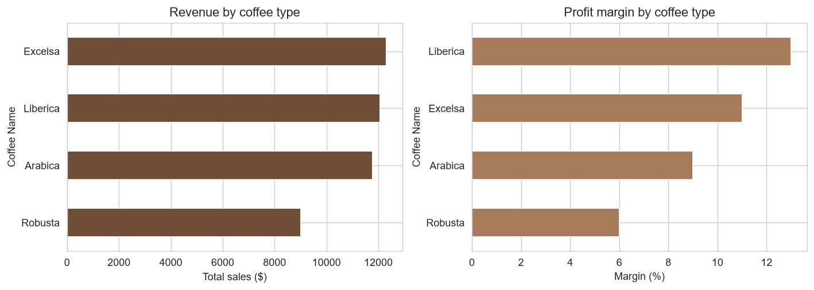
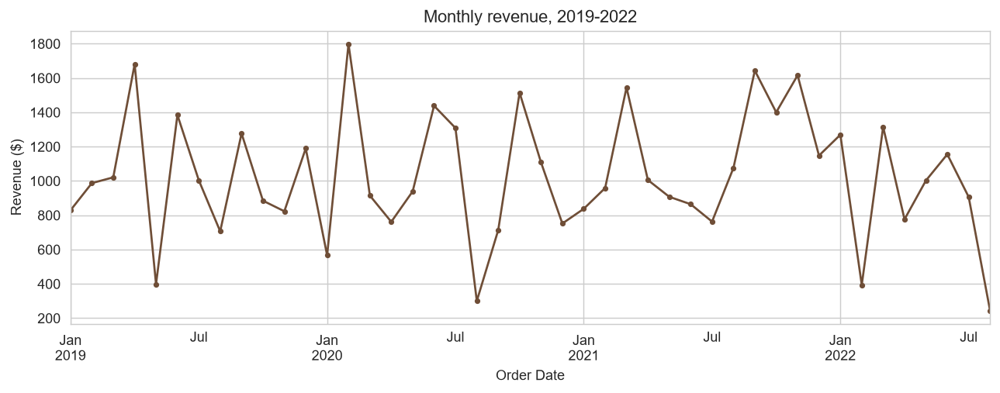
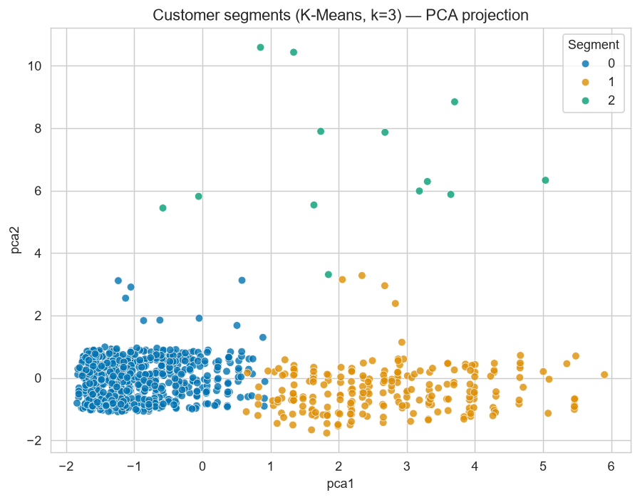
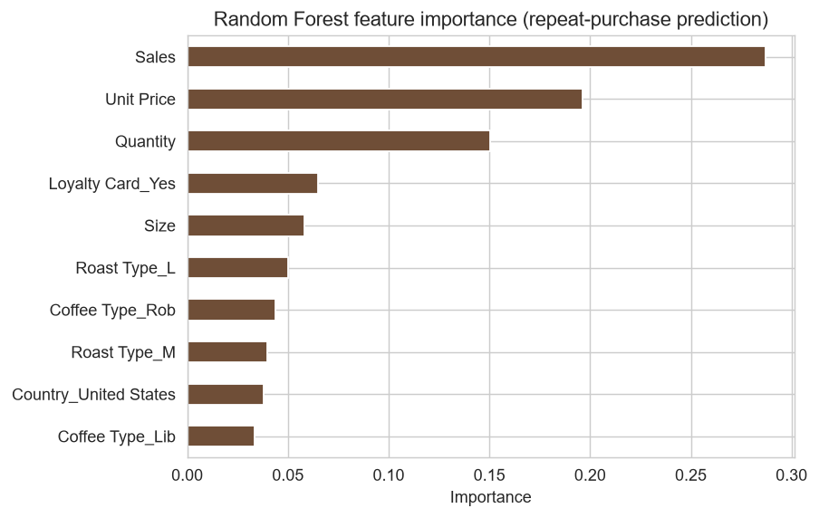
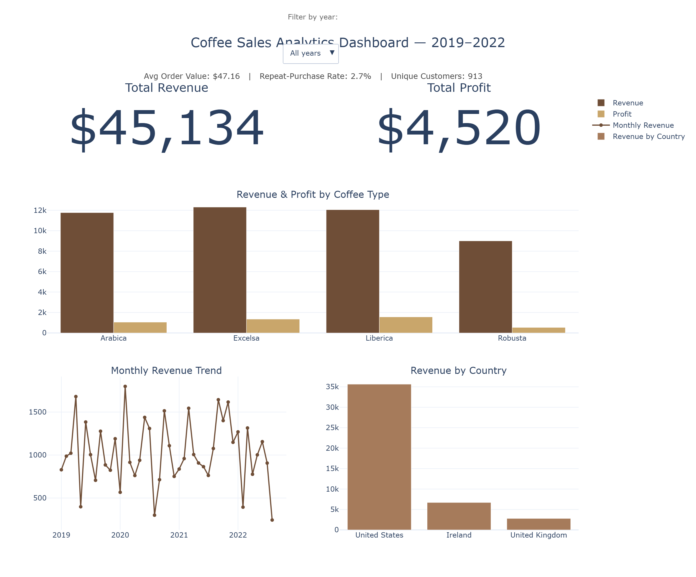

# Coffee Sales Analytics and Customer Purchase Prediction

**An end-to-end data project: Excel → SQL → Python → Machine Learning → Interactive Dashboard**

> Full write-up: [report/Technical_Report.pdf](report/Technical_Report.pdf) · Interactive dashboard: [dashboard/coffee_sales_dashboard.html](dashboard/coffee_sales_dashboard.html)

## In short

- **What:** I analysed three years of coffee orders to find which products and customers drive sales, and tested whether repeat purchases could be predicted.
- **Data:** 1,000 orders from 913 customers in the United States, United Kingdom, and Ireland (2019 to 2022).
- **Tools:** Excel, SQL (SQLite), Python (pandas, scikit-learn), Plotly.
- **Main findings:**
  - Excelsa brought in the most revenue, but Liberica had the highest profit margin (13%).
  - Only 2.7% of customers bought again, and loyalty card members did not spend more than other customers.
  - Customers fell into three clear groups: occasional buyers, bulk buyers, and a small group of high-value repeat buyers.
  - The repeat-purchase model was only slightly better than guessing, because there were too few repeat customers to learn from.

---

## Problem

A coffee retailer selling **Arabica, Excelsa, Liberica, and Robusta** beans in the **United States, United Kingdom, and Ireland** had three years of order data (2019 to 2022) sitting in a spreadsheet. The data was only being used for basic reporting, with nothing connecting it to deeper analysis or prediction.

In this project, I built a complete workflow from the raw spreadsheet to SQL analysis, machine learning, and an interactive dashboard. I also wanted to be clear about where the data supports a strong conclusion and where it does not.

**Research questions:**
- Which coffee type and roast generate the highest revenue and profit?
- Which customer characteristics, if any, predict repeat purchases?
- Can customers be grouped into meaningful purchasing segments?
- Does the loyalty card programme increase customer spending?
- What seasonal and country-level patterns exist in sales?

---

## Dataset

Source: [`data/raw_data.xlsx`](data/raw_data.xlsx). It has 1,000 order lines, 913 unique customers, and 48 products (4 coffee types × 3 roasts × 4 bag sizes), from January 2019 to August 2022.

| Table | Rows | Key fields |
|---|---|---|
| `orders` | 1,000 order lines | Order ID, Date, Customer ID, Product ID, Quantity, Country, Coffee/Roast Type, Size, Unit Price, Sales, Loyalty Card |
| `customers` | 913 unique | Customer ID, Country, Loyalty Card |
| `products` | 48 products | Product ID, Coffee/Roast Type, Size, Unit Price, Profit |

**Privacy note:** the raw workbook includes customer names, email addresses, phone numbers, and postal addresses. None of these are needed for the analysis, so I removed them in [`notebooks/01_data_cleaning.ipynb`](notebooks/01_data_cleaning.ipynb) before saving any cleaned file. Only the anonymous Customer ID is kept. See [`data/cleaned_data.csv`](data/cleaned_data.csv).

---

## Methods

| Step | What I did | Files |
|---|---|---|
| **Cleaning** | Loaded the raw workbook, checked for missing values and duplicates, confirmed every order links to a valid customer and product, checked that Sales = Quantity × Unit Price, removed personal information, and exported clean CSVs | [`notebooks/01_data_cleaning.ipynb`](notebooks/01_data_cleaning.ipynb) |
| **SQL** | Built a SQLite database with separate tables, ran validation checks, and wrote 10 queries for the business questions (joins, window functions, ranking, customer lifetime value) | [`sql/`](sql/) |
| **Exploratory analysis** | Revenue and margin by product, spending by country, loyalty card comparison, seasonality, and correlations | [`notebooks/02_exploratory_analysis.ipynb`](notebooks/02_exploratory_analysis.ipynb) |
| **Machine learning** | K-Means customer segmentation and a repeat-purchase classification model | [`notebooks/03_machine_learning.ipynb`](notebooks/03_machine_learning.ipynb) |
| **Dashboard** | An interactive HTML dashboard with KPIs and a year filter | [`dashboard/coffee_sales_dashboard.html`](dashboard/coffee_sales_dashboard.html) |
| **Report** | A full technical report | [`report/Technical_Report.pdf`](report/Technical_Report.pdf) |

---

## Results

- Excelsa generated the highest revenue ($12,306), while Liberica had the highest profit margin (13%).
- The 2.5 kg coffee size accounted for 52.7% of total revenue, making it the top-selling product size.
- Only 25 out of 913 customers (2.7%) made a repeat purchase, indicating a low customer retention rate.
- Customers enrolled in the loyalty programme did not spend more than non-members.
- Sales peaked in June and were lowest in August. The 2022 sales trend also suggests slower growth compared to 2021.
- The United Kingdom recorded the lowest revenue and spending per customer, suggesting an opportunity to improve customer engagement.




---

## Machine Learning

### Customer segmentation (K-Means)

I grouped customers using how recently they bought, how often they bought, how much they spent, their average order value, the average price they paid, and how often they bought the 2.5 kg size. Three groups gave the clearest separation (silhouette score 0.555):

| Segment | Customers | Share | Avg. spend | % repeat |
|---|---|---|---|---|
| Occasional / low-spend buyers | 671 | 73.5% | $29.75 | 1% |
| Bulk buyers | 229 | 25.1% | $98.77 | 2% |
| High-value / repeat buyers | 13 | 1.4% | $196.28 | 100% |



### Repeat-purchase prediction

Only 25 of the 913 customers ever bought again, so a model that simply predicts "no repeat" for everyone is already 97.4% accurate. That means accuracy on its own says very little here.

I trained a Logistic Regression and a Random Forest model, both adjusted for the imbalance, using only information available at each customer's first order. Information from later purchases was left out because it would give the model the answer. Both models scored a **ROC-AUC of 0.51 and 0.52**, which is only slightly better than random guessing.

With only 25 repeat customers, the data does not contain enough information to reliably predict repeat purchases. I have reported this result as it is, and the customer segmentation turned out to be the more useful part of the analysis. More detail is in the [technical report](report/Technical_Report.pdf), Section 6.2.



---

## Dashboard

The dashboard is a single HTML file built with Plotly. You can filter by year, and every KPI and chart updates.



---

## Installation

```bash
git clone https://github.com/Valerie-komen/Coffee-Sales-Analytics-ML.git
cd Coffee-Sales-Analytics-ML
pip install -r requirements.txt
```

## Reproducibility

Run the steps in order. Each step uses the output of the one before it, and all outputs are already in the repository, so you can also look at any step without rerunning it.

1. **Data cleaning:** run [`notebooks/01_data_cleaning.ipynb`](notebooks/01_data_cleaning.ipynb). This produces `data/cleaned_data.csv`, `data/customers_clean.csv`, and `data/products_clean.csv`.
2. **SQL:** use `sqlite3` (or any SQL engine) with [`sql/database_creation.sql`](sql/database_creation.sql), then run [`sql/cleaning_queries.sql`](sql/cleaning_queries.sql) and [`sql/analysis_queries.sql`](sql/analysis_queries.sql).
3. **Exploratory analysis:** [`notebooks/02_exploratory_analysis.ipynb`](notebooks/02_exploratory_analysis.ipynb).
4. **Machine learning:** [`notebooks/03_machine_learning.ipynb`](notebooks/03_machine_learning.ipynb).
5. **Dashboard:** open [`dashboard/coffee_sales_dashboard.html`](dashboard/coffee_sales_dashboard.html) in a browser. No server is needed.

All notebook outputs in this repository are from real runs of the code.

---

## Repository Structure

```
Coffee-Sales-Analytics-ML/
├── README.md
├── requirements.txt
├── data/
│   ├── raw_data.xlsx
│   ├── cleaned_data.csv
│   ├── customers_clean.csv
│   ├── products_clean.csv
│   └── coffee_sales.db
├── notebooks/
│   ├── 01_data_cleaning.ipynb
│   ├── 02_exploratory_analysis.ipynb
│   └── 03_machine_learning.ipynb
├── sql/
│   ├── database_creation.sql
│   ├── cleaning_queries.sql
│   └── analysis_queries.sql
├── dashboard/
│   └── coffee_sales_dashboard.html
├── images/
│   ├── dashboard.png
│   ├── revenue_vs_margin.png
│   ├── monthly_seasonality.png
│   ├── loyalty_boxplot.png
│   ├── correlation_heatmap.png
│   ├── roast_distribution.png
│   ├── customer_segments.png
│   ├── confusion_matrix.png
│   ├── feature_importance.png
│   └── roc_curve.png
└── report/
    ├── Technical_Report.pdf
    └── Technical_Report.docx
```

---

## Limitations and Future Work

The dataset is small (913 customers, only 25 repeat buyers) and has no demographic, marketing, or economic information, which limits what any model trained on it can show. In future, I would collect more customer behaviour data to improve repeat-purchase prediction, connect the dashboard to a live database, add sales forecasting, and compare customer acquisition cost with customer lifetime value. Sections 9 and 10 of the [technical report](report/Technical_Report.pdf) cover this in more detail.

## Responsible AI

Personal information was removed before any file was saved to this repository. Most of the revenue (79%) comes from the United States, so the findings are likely to represent US customers better than UK and Irish customers. The repeat-purchase model is reported exactly as it performed. See Section 11 of the [technical report](report/Technical_Report.pdf).

---

*If you have questions or feedback, feel free to open an issue or connect with me on [LinkedIn](https://www.linkedin.com/in/valerie-komen-468a93355/).*
